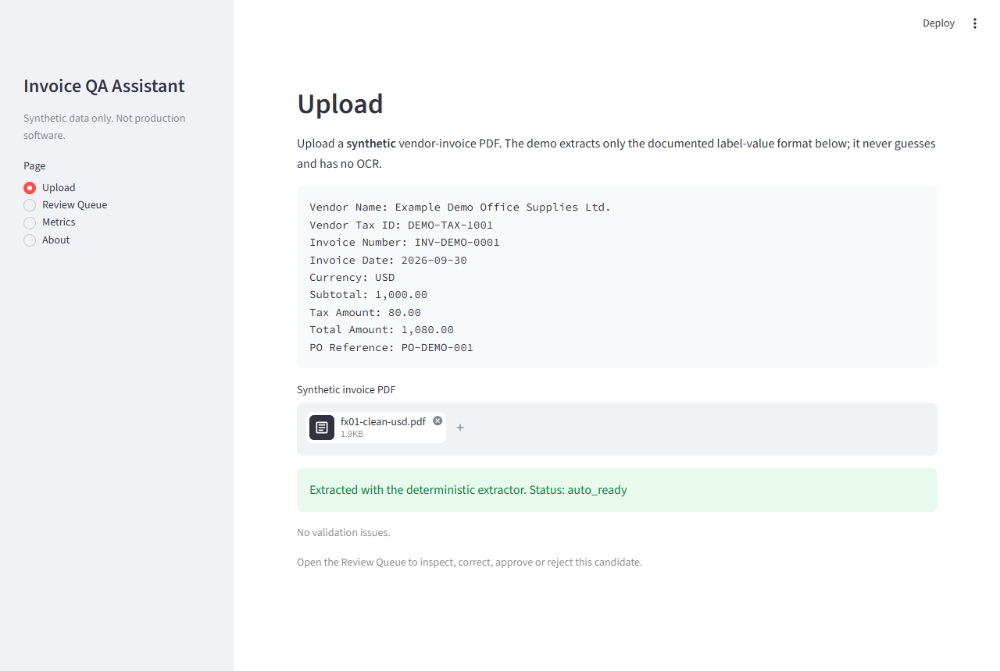
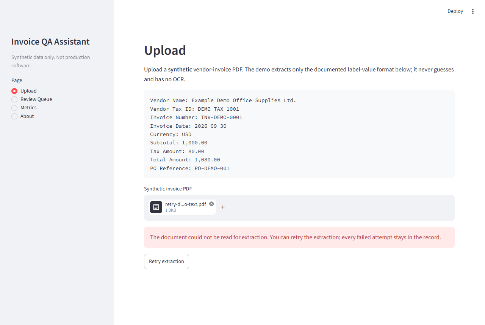
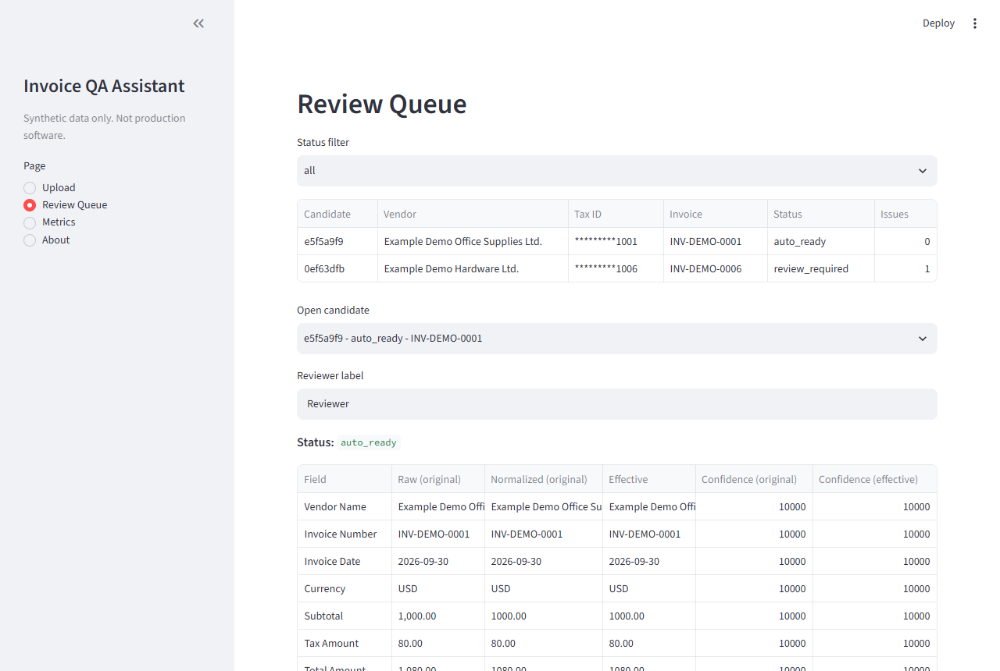
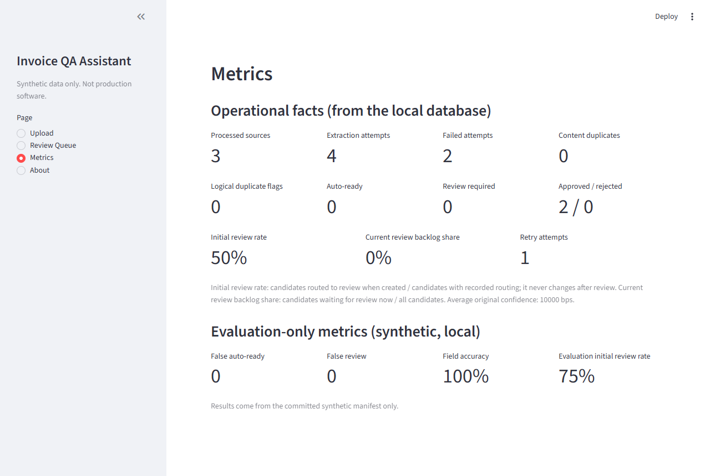

# Vendor Invoice Digitization & QA Assistant

A local, network-free portfolio MVP that turns **synthetic** vendor-invoice PDFs into
validated structured records, routes uncertain or invalid results to a human reviewer,
keeps append-only evidence, and exports approved data.

> Synthetic data only. Not production software. No claim is made about real-world accuracy,
> regulatory compliance, customer usage or time savings.

## 1. Overview

Streamlit UI over plain-Python services, a domain layer with exact `Decimal`/date rules, and
a local SQLite database. Extraction is deterministic (no model, no network). An AI-provider
protocol, a test-only fake and a Pydantic validation boundary demonstrate structured-output
handling; no real provider is connected.

## 2. Business problem

Accounts-payable and operations teams re-key semi-structured vendor invoices. Manual entry is
slow and error-prone (identity, date, currency, tax, arithmetic, duplicates, PO references),
while fully automatic extraction is risky on unfamiliar layouts, conflicting values or low
confidence. This demo shows a controlled middle path: automate the clean cases, make every
exception visible, and require a deliberate human approval.

## 3. Intended user

A non-technical operations analyst who uploads invoices, reviews exceptions, compares raw and
normalized values, corrects or confirms fields, approves valid records, rejects invalid ones,
and exports approved data.

## 4. Workflow

```text
Synthetic PDF -> file-security checks -> deterministic text extraction -> raw field evidence
  -> exact normalization -> validation + duplicate detection -> exception-based review
  -> approve / reject -> approved CSV/JSON export -> append-only audit history + metrics
```

### Demo screenshots

| Clean invoice upload | Explicit extraction retry |
|---|---|
|  |  |

| Human review queue | Operational and evaluation metrics |
|---|---|
|  |  |

## 5. Features

- Upload, Review Queue, Metrics and About pages.
- Raw vs. original-normalized vs. effective value comparison with original and effective
  confidence.
- Field-level correction errors, confirmation of low-confidence fields only, duplicate
  resolution, approval with re-validation, rejection with a reason.
- Content-duplicate and logical-duplicate handling. A document that is already known never
  extracts again on its own; after an extraction error the user can choose **Retry extraction**.
  Every attempt (failed, interrupted or successful) is kept as an immutable, numbered row.
  A successful extraction and its candidate are written in one database transaction, so a
  succeeded attempt never exists without its candidate. An attempt that is still running
  (younger than 10 minutes) is never interrupted by a second session; the UI says extraction
  is already in progress.
- Metrics separate the **initial review rate** (routing recorded when the candidate was
  created, never rewritten) from the **current review backlog share** (waiting for review now).
- Approved-only export (CSV/JSON) with masked vendor tax IDs.
- Reproducible 13-scenario synthetic evaluation with false-auto-ready / false-review counts.

## 6. Architecture

```text
app.py                     Streamlit entry point (sidebar navigation)
src/invoice_qa/
  domain/                  models, normalization, validation, transitions (no I/O)
  extraction/              Extractor protocol, DeterministicExtractor, AI boundary
  infrastructure/          SQLite repository, file-security checks
  services/                intake, review, metrics, export
  ui/                      page renderers and display helpers
  synthetic.py             deterministic PDF builder shared by tests and the generator
sample_data/, scripts/     manifest, generator, evaluator
```

A short-lived SQLite connection is opened per repository operation. "Today" is injected
through a clock dependency; domain and service code never read the system clock.

## 7. Validation and confidence rules

- Supported currencies: `USD`, `EUR`, `GBP`, `SGD`, `VND`. Dates accept ISO `YYYY-MM-DD` only.
- Amounts must match `^[+-]?(\d{1,3}(,\d{3})+|\d+)(\.\d+)?$`; locale variants such as
  `1.000,00` are malformed, never inferred.
- Allowed fractional digits: `VND` 0, others 2. Fewer digits are padded exactly; more digits
  are `malformed_value`. Nothing is ever rounded.
- Vendor tax IDs must match `DEMO-TAX-\d{4}` after trim and uppercase.
- Blocking issues: `missing_required_field`, `malformed_value`, `unsupported_currency`,
  `future_invoice_date`, `invalid_amount_sign`, `arithmetic_mismatch`, `conflicting_values`,
  `possible_logical_duplicate`. Review warnings: `low_field_confidence` (< 8000 bps),
  `low_overall_confidence` (< 8500 bps). Advisory: `missing_po_reference`.
- Confidence is in integer basis points (`10000` = 100%): exact label 10000, documented alias
  9000, loose alias 7500 (one field only), missing or conflicting 0. Overall confidence is
  the floor mean over the seven required fields.
- The overall-confidence warning is **not** a frequent gate: because only one field can use
  the 7500 loose alias, it fires only when a required field is missing or conflicting and
  another required field is also below 10000 (for example 8428).

## 8. Human-in-the-loop controls

- A clean candidate becomes `auto_ready` but still needs a deliberate human approval.
- Confirmation resolves only `low_field_confidence`; blocking issues need a valid correction.
- Approval re-runs validation and duplicate detection; a newer duplicate blocks approval,
  returns the candidate to `review_required` and records an `approval_blocked` event.
- `approved` and `rejected` are terminal. Reopen is production hardening.
- Corrections and events commit atomically; SQLite triggers reject `UPDATE`/`DELETE` on
  review events and any change to original evidence.

## 9. Security and privacy

See [SECURITY.md](SECURITY.md). In short: PDF only, at most 5 MiB (enforced by the Streamlit
widget, server config and the application), non-encrypted, structurally readable, at least one
page; PDF bytes and full extracted text are never stored; vendor tax IDs are masked outside an
explicit session-only edit action; UI errors are generic.

## 10. Synthetic evaluation methodology and measured results

`sample_data/manifest.json` defines 13 fixtures (clean USD, clean VND, no PO, missing invoice
number, unsupported currency, malformed amount, arithmetic mismatch, future date,
low-confidence alias, conflicting total, content duplicate, logical duplicate, excess
fractional digits) with expected normalized values, confidence, exact issue-code sets and
initial status. `scripts/evaluate.py` processes them in manifest order against a fresh
temporary database with a fixed reference date.

Measured on 2026-10-10 (synthetic, local; code baseline in `REVIEW_HANDOFF.md`):

| Metric | Result |
|---|---|
| Scenarios matching the manifest | 13 / 13 |
| Field-level accuracy (fields with defined ground truth) | 111 / 111 |
| Initial review rate (review_required at creation / new candidates) | 0.75 (9 of 12) |
| False auto-ready | 0 |
| False review | 0 |

These numbers describe a small, hand-built, synthetic set whose expectations were written
alongside the rules; they are a regression check, **not** evidence of real-world accuracy.

## 11. Local setup

Requires Python 3.11 or newer.

```bash
python -m venv .venv
.venv/Scripts/python -m pip install -e ".[dev]"     # Windows; use .venv/bin/python elsewhere
.venv/Scripts/python -m pytest -q
.venv/Scripts/ruff check .
.venv/Scripts/python sample_data/generate_samples.py
.venv/Scripts/python scripts/evaluate.py --manifest sample_data/manifest.json --output .evaluation/report.json
.venv/Scripts/streamlit run app.py
```

Configuration is read from the process environment only (`.env.example` documents
`INVOICE_QA_DB_PATH`; no dotenv loader). Default database: `.data/invoice_qa.sqlite3`
(gitignored).

## 12. Demo walkthrough

1. Run the generator (13 evaluation PDFs plus the no-text retry sample), then start the app.
2. Upload `sample_data/generated/fx01-clean-usd.pdf`; it routes to `auto_ready`.
3. Upload `fx06-malformed-amount.pdf`; open the Review Queue, correct `Subtotal` to
   `1,000.00` and watch the status change.
4. Upload `fx09-low-confidence-alias.pdf`; confirm `vendor_name` (the only confirmable field).
5. Upload `fx12-logical-duplicate.pdf`; resolve it by rejecting or confirming distinctness.
6. Approve a candidate, then download the approved CSV/JSON from the Review Queue.
7. Open Metrics: **Initial review rate** stays where it was after you approve or reject, while
   **Current review backlog share** falls; run the evaluator command shown there to populate
   evaluation-only numbers.
8. Extraction retry (see `screenshots/03-extraction-error-with-retry.png` and
   `screenshots/04-after-manual-retry.png`): upload `sample_data/generated/retry-demo-no-text.pdf` (written by the
   generator, a valid PDF with no text layer). The page shows an extraction error and a
   **Retry extraction** button. Nothing retries until you click it; each click adds a numbered
   attempt and keeps the failed ones (it fails again here by design, because the file never
   has text). Metrics then show the failed attempts and retry attempts.

## 13. Known limitations

- Only the documented label-value format is supported; no OCR, no fuzzy matching.
- Retry is manual only (no automatic retry, backoff or limit on attempts). The PDF is never
  stored, so a retry needs the same file uploaded again.
- A `started` attempt younger than 10 minutes (`STALE_ATTEMPT_AFTER` in
  `infrastructure/database.py`, measured with the injected database clock) is treated as
  running: a second session gets an "already in progress" result and changes nothing. Only an
  attempt at least 10 minutes old is preserved as `extraction_interrupted` when the user retries.
  The threshold is a fixed guess, not derived from measurements; an extraction that really runs
  longer than that could still be interrupted, and a crashed one blocks retry for up to 10 minutes.
- A succeeded attempt that has no candidate (only possible from data written before extraction
  and candidate creation became one transaction) is repaired on the next upload or retry of that
  file by rebuilding the candidate from the stored raw extraction; the PDF is not re-extracted.
  The rebuilt candidate is validated against today's date and the current duplicates.
- A database created before retry existed is upgraded in place on first start; its candidates
  have no recorded initial routing and are excluded from the initial review rate.
- Uploads rejected by file-security checks are shown to the user but not counted in metrics.
- No authentication, roles, multi-tenancy or retention policy.
- Out of scope: credit notes, multi-rate VAT, withholding tax, rounding adjustments,
  multi-currency invoices, email ingestion, ERP/payment integrations, real AI providers.
- Fixture byte reproducibility holds only for the pinned ReportLab version.
- Verified locally on Python 3.14.6 and 3.11.15 (Windows 11, full test suite, Ruff and the
  evaluator on both). Other platforms and Python 3.12/3.13 for this revision were not run.
- Screenshots in `screenshots/` come from one scripted browser run on synthetic data; no
  manual browser session was performed.

## 14. Production hardening (not done)

Authentication and RBAC, managed database and retention, monitoring and alerting, a reopen
flow, automatic retry policy, OCR, ERP integration, real-provider integration with its own threat
model, and a legal/privacy review.

## 15. Dependency licenses

Direct dependencies: Streamlit, pypdf, ReportLab, Pydantic, pandas (runtime); pytest, Ruff
(development). pypdf and ReportLab are permissive open-source libraries. This is not legal
advice; confirm licenses before redistribution.

## 16. Project license status

Licensed under the [MIT License](LICENSE).
